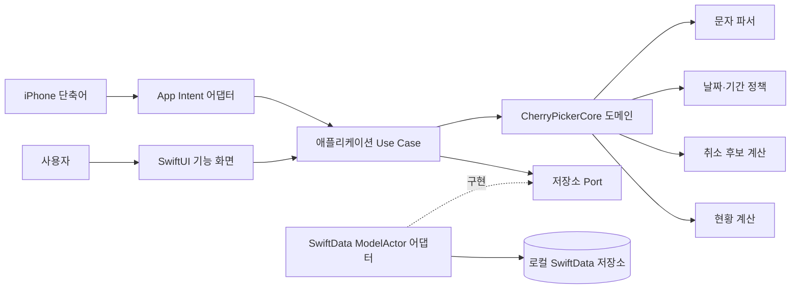
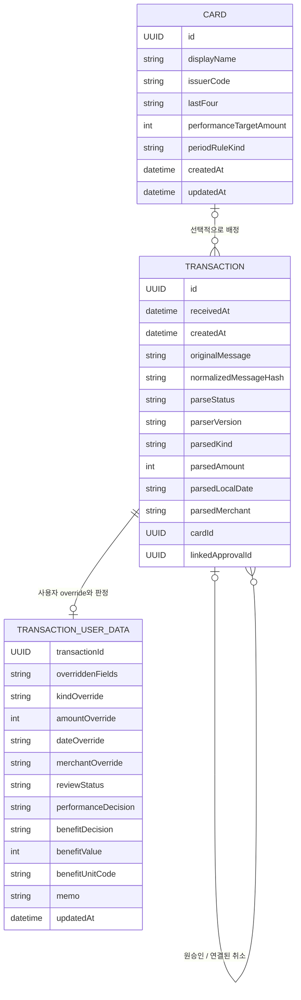
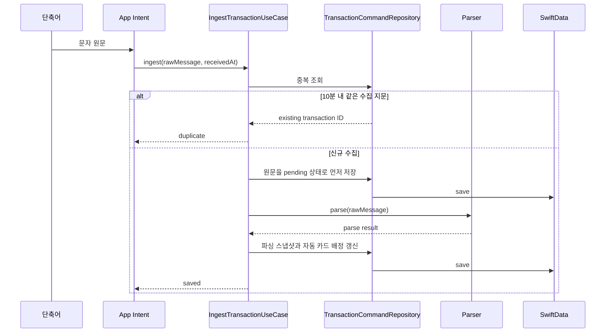

# CherryPicker 아키텍처

- 상태: 승인됨
- 기준일: 2026-08-05
- 대상 이슈: [#6 카드·거래·집계 도메인 구조 확정](https://github.com/metishonora/CherryPicker/issues/6)
- 후속 기능: [#2 카드 설정](https://github.com/metishonora/CherryPicker/issues/2), [#3 승인취소 연결](https://github.com/metishonora/CherryPicker/issues/3), [#4 현황 대시보드](https://github.com/metishonora/CherryPicker/issues/4)

## 1. 목적과 범위

이 문서는 문자 수집 기술 검증 이후의 기준 아키텍처다. 목표는 모든 기능 정책을 미리 확정하는 것이 아니라, 정책이 바뀌더라도 저장 스키마와 책임 경계를 다시 설계하지 않게 하는 것이다.

이 문서가 확정하는 내용은 다음과 같다.

- Card, Transaction, 승인–취소 연결의 관계와 불변조건
- 원문, 파싱 스냅샷, 사용자 수정값의 소유권
- 날짜 해석, 후보 검색, 집계를 교체 가능한 정책으로 두는 경계
- App Intent와 앱 UI가 같은 로컬 저장소를 사용하는 방식
- SwiftData 스키마 버전과 기존 실기기 데이터 마이그레이션 원칙
- 민감한 원문과 구조화된 진단값의 저장·노출 원칙
- 도메인, 애플리케이션, 저장소, UI의 테스트 경계

실적 기간의 정확한 기본값, 날짜 추론 허용 범위, 취소 후보 점수, 취소의 기간별 집계 방식과 같은 기능 정책은 각 기능 이슈에서 예제 기반으로 확정한다. 이 문서는 그 정책을 구현할 자리를 정의한다.

## 2. 핵심 결정

| 영역 | 결정 |
|---|---|
| 식별 | Card와 Transaction은 표시값과 무관한 UUID를 안정적인 식별자로 사용한다. 원문 지문은 수집 중복 판정용이며 거래 식별자가 아니다. |
| 카드 관계 | 한 Card는 여러 Transaction을 가진다. Transaction의 Card 관계는 파싱 실패와 마이그레이션을 위해 선택적이다. |
| 승인취소 | 취소는 독립 Transaction이다. 취소는 최대 한 승인과 연결되고, 승인은 여러 취소를 받을 수 있다. 연결은 사용자 명령으로만 생성한다. |
| 값 소유권 | 원문은 불변 수집 사실, 파싱 결과는 교체 가능한 스냅샷, 사용자 수정값은 별도 override다. 유효값은 `사용자 override ?? 파싱값`이다. |
| 날짜 | 원문에서 얻은 부분 날짜와 해석된 날짜를 구분한다. 날짜 해석 알고리즘은 버전이 있는 정책이며 사용자 확정 날짜를 덮어쓰지 않는다. |
| 집계 | 대시보드 값과 취소 후보 점수는 저장하지 않는다. Sendable 스냅샷을 입력으로 받는 순수 도메인 서비스가 계산한다. |
| 저장소 | SwiftData는 앱 전용 어댑터다. 모든 쓰기는 `@ModelActor` 기반 명령 저장소를 거치고, 영속 모델을 actor 경계 밖으로 전달하지 않는다. |
| 프로세스 | 앱 UI와 App Intent는 같은 스키마, 마이그레이션 계획, 저장 URL을 만드는 Composition Root를 공유한다. 각 실행 환경은 자기 ModelContainer를 가질 수 있다. |
| 마이그레이션 | 현재 실기기 스키마를 V1로 고정하고 이후 모든 변경에 VersionedSchema와 SchemaMigrationPlan을 사용한다. 실패 시 저장소를 삭제하거나 빈 저장소로 대체하지 않는다. |
| 민감 정보 | 원문은 재파싱과 진단을 위해 기기에 보존하되 기본 화면, 로그, 집계에서 숨긴다. CloudKit과 외부 전송은 사용하지 않는다. |

관련 근거와 대안은 [ADR 목록](#11-adr)에 기록한다.

## 3. 시스템 경계와 의존 방향



의존 방향은 바깥에서 안쪽으로만 향한다.

- `CherryPickerCore`는 SwiftUI, AppIntents, SwiftData에 의존하지 않는다.
- 애플리케이션 Use Case는 도메인 타입과 저장소 프로토콜만 안다.
- SwiftData 모델과 ModelContext는 Persistence 모듈 밖으로 노출하지 않는다.
- SwiftUI와 App Intent는 동일한 Use Case를 호출하는 입력 어댑터다.

권장 파일 구조는 다음과 같다. 실제 기능 구현 중 파일 수가 과도해지면 같은 책임 안에서 합칠 수 있다.

```text
Sources/CherryPickerCore/
  Domain/
  Parsing/
  Policies/
  Services/

CherryPickerApp/CherryPicker/
  Application/
    Commands/
    Queries/
    Ports/
  Persistence/
    Models/
    Migrations/
    Repositories/
  Features/
  Intents/
```

## 4. 도메인 모델

### 4.1 관계



다이어그램은 논리 모델이다. 부분 날짜와 override는 SwiftData 제약에 맞게 여러 기본 속성으로 평탄화할 수 있지만 소유권은 유지해야 한다.

### 4.2 Card

Card의 UUID만 관계 식별자다. 표시 이름, 카드사, 끝 네 자리는 수정 가능한 속성이다.

- `issuerCode + lastFour`가 정확히 한 Card와 일치할 때만 자동 배정한다.
- 일치하는 카드가 없거나 둘 이상이면 Transaction을 미배정 상태로 보존한다.
- Card 삭제의 관계 규칙은 `nullify`다. 거래와 원문을 연쇄 삭제하지 않는다.
- 실적 목표와 기간 규칙은 Card 설정에 속하지만, 선택한 조회 기간 자체는 대시보드 상태이며 저장된 집계가 아니다.
- 기간 규칙은 종류 식별자와 선택적 매개변수로 표현해 달력 월, 반복 주기, 고정 구간을 수용한다. #2가 MVP에서 노출할 종류를 결정한다.

### 4.3 Transaction의 세 층

Transaction은 다음 세 층을 구분한다.

1. 수집 사실
   - UUID, 수신 시각, 생성 시각, 원문, 정규화 지문
   - 생성 후 변경하지 않는다.
2. 파싱 스냅샷
   - 파싱 상태·버전·실패 이유
   - 종류, 카드 끝 네 자리, 금액, 부분 날짜, 가맹점, 선택적 잔액
   - 새 파서로 명시적으로 재처리할 수 있다.
3. 사용자 데이터
   - 필드별 override 존재 여부와 값
   - 카드 배정과 배정 출처
   - 검토 상태, 실적·혜택 판정, 혜택 값·단위, 메모

기존 `hasUserEdits`처럼 거래 전체를 한 번에 동결하지 않는다. 각 override는 “없음”과 “사용자가 값을 비움”을 구분할 수 있어야 한다. 예를 들어 시각을 제거하는 날짜 override는 별도 존재 플래그와 날짜 정밀도를 가진다.

도메인과 UI가 읽는 `TransactionSnapshot`은 세 층을 합친 불변 Sendable 값이다. 파싱값이나 SwiftData 모델을 직접 집계에 전달하지 않는다.

### 4.4 날짜와 기간

문자 날짜는 완전한 `Date`가 아니라 지역 달력의 부분 날짜다.

```text
ParsedLocalDate
  year: nil
  month/day: required when parsed
  hour/minute: both present or both absent
  calendarIdentifier
  timeZoneIdentifier
  precision: day | minute
```

`TransactionDateResolver`는 부분 날짜와 수신 시각을 받아 해석 결과를 만든다.

```text
ResolvedTransactionDate
  localComponents
  instantForOrdering
  precision
  resolutionSource: inferred | legacyReceivedYear | user
  resolverVersion
```

- 해석 결과와 resolver 버전을 저장해 앱 업데이트만으로 과거 거래가 다른 기간으로 이동하지 않게 한다.
- 사용자 날짜 override가 있으면 해석 정책보다 항상 우선한다.
- 날짜만 있는 거래의 목록 정렬은 `receivedAt`을 사용한다.
- 집계 기간은 시작 포함·끝 미포함 `DateInterval` 의미를 사용한다. 구체적인 기간 생성 규칙은 #2에서 결정한다.

### 4.5 승인–취소 연결

승인취소 관계는 Transaction의 선택적 자기 참조다.

- 취소의 `linkedApproval`은 0 또는 1개다.
- 승인의 역관계 `linkedCancellations`는 0개 이상이다.
- 취소는 연결되지 않아도 완전한 거래로 저장되고 조회된다.
- 후보는 `CancellationMatcher`가 계산하며 저장하지 않는다.
- 후보 제안은 연결을 만들지 않는다. `linkCancellation` 사용자 명령만 관계를 변경한다.
- 승인 삭제 시 취소 관계를 해제하고 취소 거래는 보존한다.

부분취소 허용, 초과취소 처리, 후보 점수, 기간 간 취소 집계는 #3과 #4의 기능 정책이다. 현재 관계는 그 정책들을 표현할 수 있다.

### 4.6 혜택

혜택은 값과 단위를 함께 표현한다.

```text
BenefitValue
  value: nonnegative integer
  unitCode: stable string such as KRW or a future point scheme code
```

값과 단위는 둘 다 있거나 둘 다 없어야 한다. 대시보드 계산기는 서로 다른 단위를 합치지 않고 단위별 결과를 만든다. #4가 MVP에서 표시할 단위와 환산 여부를 결정한다.

## 5. 데이터 흐름

### 5.1 문자 수집



파싱 실패나 중단은 원문을 잃게 하지 않는다. `pending` 또는 `failed` 거래는 명시적인 재처리 Use Case가 처리한다. 중복 판정 자체와 재파싱은 별도 책임이다.

### 5.2 사용자 수정과 연결

```text
SwiftUI Form
  → 값 타입 Command 생성
  → Use Case가 입력 검증
  → ModelActor 저장소가 현재 상태에서 불변조건 재검증
  → 사용자 데이터 또는 관계만 저장
  → 새 TransactionSnapshot 반환
```

SwiftUI 화면은 `@Model` 속성을 직접 변경하지 않는다. 화면 입력은 draft로 유지하고 저장 시 명령으로 전달한다.

### 5.3 대시보드

```text
CardSnapshot + 선택한 기간
  → TransactionQueryRepository가 관련 TransactionSnapshot 조회
  → PerformancePeriodResolver가 DateInterval 생성
  → DashboardCalculator가 단위별 Summary 계산
  → SwiftUI 표시
```

Summary는 저장하지 않는다. 카드 설정, 판정, 거래 날짜, 취소 연결이 바뀌면 같은 입력으로 다시 계산한다.

## 6. 명시적 인터페이스

아래 코드는 구현이 따라야 할 포트의 형태다. 이름은 구현 중 Swift 스타일에 맞게 조정할 수 있지만 입력·출력 소유권과 actor 경계는 변경하지 않는다.

```swift
public protocol CardRepository: Sendable {
    func cards() async throws -> [CardSnapshot]
    func card(id: CardID) async throws -> CardSnapshot?
    func save(_ command: SaveCardCommand) async throws -> CardSnapshot
    func delete(id: CardID) async throws
}

public protocol TransactionCommandRepository: Sendable {
    func ingest(_ input: IngestTransactionInput) async throws -> IngestOutcome
    func update(id: TransactionID, patch: TransactionUserPatch) async throws -> TransactionSnapshot
    func reparse(id: TransactionID) async throws -> TransactionSnapshot
    func delete(id: TransactionID) async throws
    func linkCancellation(_ cancellationID: TransactionID, to approvalID: TransactionID) async throws
    func unlinkCancellation(_ cancellationID: TransactionID) async throws
}

public protocol TransactionQueryRepository: Sendable {
    func transaction(id: TransactionID) async throws -> TransactionSnapshot?
    func transactions(_ query: TransactionQuery) async throws -> [TransactionSnapshot]
}
```

#2가 사용하는 도메인 정책:

```swift
public protocol PerformancePeriodResolving: Sendable {
    func period(containing date: Date, rule: PerformancePeriodRule) throws -> DateInterval
}

public protocol TransactionDateResolving: Sendable {
    func resolve(_ partial: ParsedLocalDate, receivedAt: Date) throws -> ResolvedTransactionDate
}
```

#3이 사용하는 도메인 정책:

```swift
public protocol CancellationCandidateFinding: Sendable {
    func candidates(
        for cancellation: TransactionSnapshot,
        among approvals: [TransactionSnapshot],
        policy: CancellationCandidatePolicy
    ) -> [CancellationCandidate]
}
```

#4가 사용하는 도메인 정책:

```swift
public protocol DashboardCalculating: Sendable {
    func summary(
        card: CardSnapshot,
        period: DateInterval,
        transactions: [TransactionSnapshot],
        policy: DashboardPolicy
    ) -> DashboardSummary
}
```

모든 Snapshot, Command, Query, Policy, Summary는 SwiftData와 무관한 `Sendable` 값 타입이다.

## 7. 불변조건

저장소 명령은 다음 조건을 저장 직전에 검증한다.

1. 모든 Card와 Transaction UUID는 생성 후 바뀌지 않는다.
2. 원문, 수신 시각, 생성 시각, 수집 지문은 생성 후 바뀌지 않는다.
3. 금액은 양의 원 단위 정수로 저장하고 승인·취소 의미는 종류와 집계 정책이 결정한다.
4. 파서는 파싱 스냅샷만 변경하고 사용자 데이터와 연결을 변경하지 않는다.
5. 사용자 override가 있는 필드는 재파싱 결과보다 우선한다.
6. Transaction의 Card 관계가 없어도 저장·수정·조회·삭제할 수 있다.
7. 연결 원본은 승인, 연결 주체는 취소여야 하며 자기 자신을 연결할 수 없다.
8. 후보 계산은 관계를 생성하지 않는다. 사용자 연결 명령만 관계를 저장한다.
9. Card 또는 승인 삭제는 거래를 연쇄 삭제하지 않고 관계를 해제한다.
10. 혜택 값과 단위는 함께 존재하거나 함께 없어야 한다.
11. 검토 상태와 실적·혜택 판정은 서로 독립적이다. 집계 포함 정책은 #4가 정의한다.
12. 파싱·날짜 해석·후보·집계 정책의 버전 변경은 사용자 override를 덮어쓰지 않는다.
13. 영속 모델 인스턴스는 ModelContext 또는 ModelActor 경계를 넘어 전달하지 않는다.
14. 대시보드 합계와 후보 점수는 영속화하지 않는다.

## 8. SwiftData와 동시성

Apple은 SwiftUI 환경의 ModelContext가 메인 actor에 묶이고 `@Query`가 같은 context를 사용한다고 설명한다. 백그라운드 저장에는 격리된 context를 직렬화하는 ModelActor를 사용한다.

CherryPicker는 다음 경계를 적용한다.

- `PersistenceController`를 Composition Root로 확장해 현재 VersionedSchema, SchemaMigrationPlan, 명시적 로컬 저장 URL을 한 곳에서 만든다.
- 앱 프로세스와 App Intent 실행 환경은 같은 설정을 사용하되 ModelContainer 인스턴스 공유를 전제로 하지 않는다.
- 쓰기 Use Case는 `@ModelActor` 저장소에서 실행한다. UI도 직접 ModelContext를 저장하지 않는다.
- 조회 저장소는 영속 모델을 Sendable Snapshot으로 변환한 뒤 반환한다.
- App Intent의 `perform()`은 저장소를 직접 조립하지 않고 주입된 `IngestTransactionUseCase`를 호출한다.
- UI는 명령 완료와 scene 활성화 시 조회를 새로 고친다. 별도 실행 환경의 변경이 기존 context에 즉시 반영된다고 가정하지 않는다.
- 동일 저장소를 두 container에서 읽고 쓰는 통합 테스트를 두어 App Intent와 UI 경로를 재현한다.

## 9. 스키마 버전과 마이그레이션

### 9.1 버전

- **V1**: 현재 실기기에 설치된 `TransactionRecord` 스키마다. 원문, 파싱 필드, 선택적 검토·판정·메모·`hasUserEdits`를 포함한다.
- **V2**: Card, 사용자 데이터/필드별 override, 부분 날짜 해석 메타데이터, 선택적 Card 관계, 선택적 승인–취소 자기 관계, 혜택 단위를 추가한다.
- V2 이후 모든 릴리스는 VersionedSchema와 SchemaMigrationPlan에 새 버전을 명시한다.

V1 코드가 아직 Git 기준선에 포함되지 않았으므로, #2 구현의 첫 변경은 현재 모델 선언을 그대로 보존한 V1 스키마와 디스크 저장소 fixture를 만드는 것이다. 모델 변경과 기준선 생성을 한 단계에서 섞지 않는다.

### 9.2 V1 → V2 보존 규칙

1. Transaction UUID, 원문, 지문, 수신 시각, 파싱 상태·버전·실패 이유를 그대로 보존한다.
2. `createdAt`이 없으면 `receivedAt`, `updatedAt`이 없으면 `receivedAt`을 사용한다.
3. `hasUserEdits == true`이면 현재 편집 가능 필드 전체를 사용자 override로 복사한다. 어떤 필드가 실제로 바뀌었는지 V1에서 알 수 없으므로 보존을 우선한다.
4. `hasUserEdits != true`이면 현재 파싱 필드를 파싱 스냅샷으로 옮긴다.
5. 검토·실적·혜택 판정과 메모는 사용자 데이터로 그대로 옮긴다.
6. 기존 `benefitAmount`는 원화와 포인트를 구분할 근거가 없으므로 단위 `legacyUnspecified`로 옮긴다. #4에서 사용자가 단위를 확정하기 전에는 서로 다른 단위 합계에 포함하지 않는다.
7. 기존 월·일의 연도 해석은 기존 화면 동작을 보존하도록 수신 연도를 사용하고 출처를 `legacyReceivedYear`로 기록한다.
8. Card 자동 배정은 `issuerCode + lastFour`가 정확히 하나의 Card와 일치할 때만 수행한다. 나머지는 미배정으로 남긴다.
9. 기존 Transaction에는 취소 연결을 추론하거나 자동 생성하지 않는다.

### 9.3 검증과 실패 처리

- V1 fixture를 V2 container로 열어 거래 수, UUID, 원문, 사용자 판정과 수정값을 비교한다.
- migration과 후속 backfill은 재실행해도 결과가 같은 idempotent 작업으로 작성한다.
- 실제 기기 업그레이드 전 V1 fixture와 복사한 진단 저장소로 시험한다.
- migration 실패 시 원본 저장소를 삭제, 재생성, 덮어쓰기하지 않는다.
- 앱은 저장소 오류를 명시적으로 표시하고 읽기 가능한 진단 정보를 제공한다. 빈 메모리 저장소를 기존 데이터가 없는 정상 상태처럼 표시하지 않는다.

Apple SwiftData는 [VersionedSchema](https://developer.apple.com/documentation/swiftdata/versionedschema)와 [SchemaMigrationPlan](https://developer.apple.com/documentation/swiftdata/schemamigrationplan)을 버전별 모델과 마이그레이션 단계의 공식 경계로 제공한다.

## 10. 민감 정보와 테스트 경계

### 10.1 민감 정보

- 원문에는 마스킹된 이름과 통장 잔액이 포함될 수 있다.
- 원문은 재파싱과 파싱 실패 진단을 위해 앱의 로컬 저장소에 보존한다.
- 원문과 잔액은 기본 목록, 대시보드, 분석 이벤트, 로그에 포함하지 않는다.
- 상세 화면에서 사용자가 명시적으로 펼쳤을 때만 원문을 표시한다.
- CloudKit, 서버 전송, 자동 백업·내보내기는 MVP 범위에 포함하지 않는다.
- 거래 삭제는 그 거래의 원문과 사용자 데이터도 함께 삭제한다. 카드 삭제는 거래 원문을 삭제하지 않는다.
- 향후 내보내기·백업 기능은 원문 포함 여부를 별도 사용자 선택으로 설계한다.

### 10.2 테스트 경계

반복 실행 절차와 원격 UI·TestFlight 운영 방법은 [`TESTING.md`](TESTING.md)를 따른다.

| 경계 | 테스트 대상 |
|---|---|
| CherryPickerCore 단위 테스트 | 파서, effective value 병합, 날짜·기간 resolver, 후보 정렬, 집계와 취소 정책 |
| 애플리케이션 Use Case 테스트 | 명령 검증, 중복 처리, 파싱 실패 보존, 사용자 override 보호, 연결 명령 흐름 |
| SwiftData 통합 테스트 | 관계·삭제 규칙, actor 격리, 두 container 접근, V1→V2 migration과 backfill |
| UI 테스트 | 설정 저장, 거래 수정, 연결·해제, 대시보드 표시의 핵심 사용자 흐름만 검증 |
| 실기기 시험 | 잠금·백그라운드 App Intent 저장과 업그레이드 후 기존 데이터 보존 |

도메인 정책 변경은 먼저 순수 입력과 기대 출력으로 실패하는 테스트를 추가한다. 문서·스타일 변경은 이 규칙에서 제외한다.

## 11. ADR

- [ADR-0001: 거래 사실, 파싱 스냅샷, 사용자값을 분리한다](adr/0001-separate-ingestion-parsing-and-user-values.md)
- [ADR-0002: 날짜·후보·집계를 파생 정책으로 분리한다](adr/0002-derived-policy-services.md)
- [ADR-0003: 모든 쓰기를 ModelActor 저장소 경계로 통합한다](adr/0003-modelactor-persistence-boundary.md)
- [ADR-0004: V1 데이터를 보존하는 버전 스키마와 로컬 민감정보 원칙을 사용한다](adr/0004-versioned-schema-and-sensitive-data.md)

## 12. 후속 이슈가 추가 아키텍처 결정 없이 사용할 수 있는 것

### #2 카드 설정

- Card UUID와 선택적 Transaction 관계
- CardRepository와 기간 resolver 포트
- 기간 규칙을 종류와 매개변수로 표현하는 저장 구조
- V1→V2 카드 생성·거래 배정 마이그레이션 원칙

### #3 승인취소 연결

- 취소 0..1 → 승인, 승인 0..N → 취소 관계
- 후보를 저장하지 않는 CancellationMatcher
- 사용자 명령만 연결을 생성하는 불변조건
- 삭제 시 nullify 규칙

### #4 대시보드

- 유효값이 적용된 TransactionSnapshot
- 저장하지 않는 DashboardCalculator와 단위별 혜택 결과
- 기간·취소 계산을 DashboardPolicy로 전달하는 경계
- 판정과 검토 상태를 독립 입력으로 제공하는 구조

각 이슈에 기록된 코너 케이스는 기능 정책과 인수 예제로 결정한다. 그 결정 때문에 SwiftData 모델, UI/Intent 경계 또는 마이그레이션 전략을 다시 설계하지 않는다.

## 13. 플랫폼 참고자료

- [SwiftData VersionedSchema](https://developer.apple.com/documentation/swiftdata/versionedschema)
- [SwiftData SchemaMigrationPlan](https://developer.apple.com/documentation/swiftdata/schemamigrationplan)
- [SwiftData concurrency support](https://developer.apple.com/documentation/swiftdata/concurrencysupport)
- [SwiftData ModelContext](https://developer.apple.com/documentation/swiftdata/modelcontext)
- [AppIntent](https://developer.apple.com/documentation/appintents/appintent)
- [Creating your first app intent](https://developer.apple.com/documentation/appintents/creating-your-first-app-intent)
