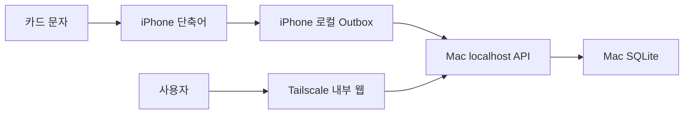

# CherryPicker 로컬 웹 제품 아키텍처

- 상태: 현재 기준
- 기준일: 2026-08-15
- 전환 계획: [이슈 #8 계획](ISSUE_8_PRODUCT_TRANSITION_PLAN.md)

## 제품 경계



- iPhone은 네트워크 요청 전에 이벤트 파일을 로컬 Outbox에 저장한다.
- Mac 서버는 앞으로 수집하는 거래를 SQLite에 저장한다.
- 브라우저와 API는 같은 Mac 서버에서 제공한다.
- 서버는 loopback에만 바인딩하고 Tailscale Serve를 외부 접근 경계로 사용한다.
- exact-login 한 명만 허용하며 공개 Funnel, 회원가입과 다중 사용자는 사용하지 않는다.

## 지금 유지하는 결정

- `eventId`는 전송 재시도의 멱등성 키다.
- 정규화한 같은 원문이 수집 시각 기준 10분 이내면 같은 canonical 거래를 가리킨다.
- 파싱 실패도 수집 성공이며 원문을 보존한다.
- 원문과 파싱 결과, 이후의 사용자 수정값은 서로 다른 소유권을 가진다.
- 사용자 수정값은 재파싱으로 덮어쓰지 않는다.
- 기본 웹, 로그와 오류에는 원문, 이름, 잔액과 인증 identity를 노출하지 않는다.
- 취소는 원승인과 연결하지 않는 독립 거래다.

## 현역 코드 경계

```text
Sources/CherryPickerCore/          파서와 순수 도메인 정책
Sources/CherryPickerServer/        HTTP 계약과 SQLite 저장
Sources/CherryPickerLocalServer/   macOS 실행 파일과 구성
Scripts/Issue7/                    제품화 전 역사적 운영 스파이크
```

네이티브 iOS 앱과 SwiftData는 제품 경계가 아니다. 기존 앱 데이터의 이전도
제품 전환의 선행 조건이 아니다.

## 구현 순서

1. 합성 이벤트가 API, SQLite와 안전한 웹 화면을 통과하는 최소 제품을 만든다.
2. #5에서 실제 거래 검토·수정 흐름을 보며 필요한 모델을 확장한다.
3. #9에서 실제 iPhone Outbox와 운영 서버를 연결한다.
4. #4에서 사용자가 확정한 판정으로 카드 현황을 계산한다.

## 의도적으로 미룬 결정

최소 제품을 사용하기 전에는 다음을 고정하지 않는다.

- 완성형 거래·카드 스키마
- 자동 백업, 장기 보존과 운영 모니터링
- 장기 SQLite migration 체계
- 상세 UI 구성과 모든 편집 필드

새 결정은 실제 제품 흐름에서 필요성이 드러난 이슈에서 가장 작은 범위로
추가한다.

## 관련 ADR

- [ADR-0001: 거래 사실, 파싱 스냅샷, 사용자값 분리](adr/0001-separate-ingestion-parsing-and-user-values.md)
- [ADR-0002: 날짜와 집계를 파생 정책으로 분리](adr/0002-derived-policy-services.md)
- [ADR-0005: 취소를 독립 음수 실적으로 계산](adr/0005-independent-cancellation-performance.md)
- [ADR-0006: 로컬 웹 제품으로 전환하고 네이티브 프로토타입을 폐기](adr/0006-local-web-product-transition.md)
