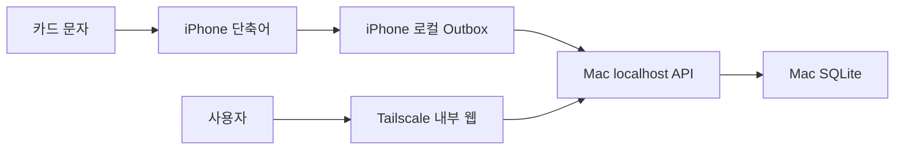
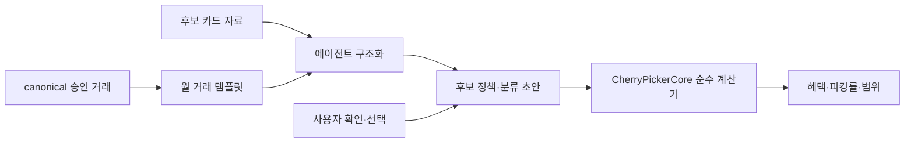

# CherryPicker 로컬 웹 제품 아키텍처

- 상태: 현재 기준
- 기준일: 2026-08-20
- 전환 계획: [이슈 #8 계획](ISSUE_8_PRODUCT_TRANSITION_PLAN.md)

## 제품 경계



- iPhone은 네트워크 요청 전에 이벤트 파일을 로컬 Outbox에 저장한다.
- Mac 서버는 앞으로 수집하는 거래를 SQLite에 저장한다.
- 브라우저와 API는 같은 Mac 서버에서 제공한다.
- 서버는 loopback에만 바인딩하고 Tailscale Serve를 외부 접근 경계로 사용한다.
- exact-login 한 명만 허용하며 공개 Funnel, 회원가입과 다중 사용자는 사용하지 않는다.

## 지금 유지하는 결정

- `eventId`는 전송 재시도의 멱등성 키다.
- 정규화한 같은 원문이 수집 시각 기준 10분 이내면 같은 canonical 거래를 가리킨다.
- 파싱 실패도 수집 성공이며 원문을 보존한다.
- 원문과 파싱 결과, 이후의 사용자 수정값은 서로 다른 소유권을 가진다.
- 사용자 수정값은 재파싱으로 덮어쓰지 않는다.
- 거래 목록·대시보드·로그와 오류에는 원문, 이름, 잔액과 인증 identity를
  노출하지 않는다. 원문은 인증된 개별 거래 상세 응답과 기본으로 접힌
  `파싱 상태 보기`에서만 제공한다.
- 취소는 원승인과 연결하지 않는 독립 거래다.
- 카드 종류는 안정적인 코드, 문자 식별·파싱 규칙, 전월 실적 구간과
  혜택 정책을 함께 소유한다. 보유 카드는 카드 종류 코드를 참조하고
  UUID, 표시 이름과 끝 네 자리만 소유한다.
- 이번 달 혜택 한도는 직전 월의 검토 확정 실적과 같은 월의 실적
  오프셋으로 계산한다. 단일 사용자 실적 목표는 사용하지 않는다.
- 혜택은 거래 발생 순서로 계산하며 승인마다 남은 혜택별·통합 한도를 적용한다.
  취소는 선택한 혜택의 할인율로 차감하고, 복원된 한도는 이후 승인부터 사용한다.
  이전 승인의 한도 초과분을 소급 지급하지 않는다. 실제 환수액과 차이가 나면
  기존 혜택 오프셋으로 보정한다.
- 이번 달 실적 합계와 자동 목표 진행도는 이번 달의 검토 확정 실적과
  같은 월의 실적 오프셋으로 계산한다.
- 실적 목표 표시는 카드 종류가 소유한 고정 실적 구간 중 현재 실적보다 높은
  다음 구간으로 자동 계산한다. 최고 구간 이후에는 최고 구간을 달성 상태로
  유지하며 보유 카드 인스턴스가 목표를 저장하거나 수정하지 않는다.

## 현역 코드 경계

```text
Sources/CherryPickerCore/          카드 종류 정의, 파서와 순수 도메인 정책
Sources/CherryPickerServer/        HTTP 계약과 SQLite 저장
Sources/CherryPickerLocalServer/   macOS 실행 파일과 구성
Scripts/LocalServer/               제품 설치·제거·fixture 검증
Scripts/Issue7/                    역사적 #7 스파이크 운영 도구
```

네이티브 iOS 앱과 SwiftData는 제품 경계가 아니다. 기존 앱 데이터의 이전도
제품 전환의 선행 조건이 아니다.

현재 지원 카드 종류는 코드 `mg.the-better-check`인
`MGTheBetterCheckCardDefinition`과 코드 `hana.mg-plus-s`인
`MGPlusSHanaCardDefinition`이다. iPhone의 메시지 자동화는 두 카드의
발신자를 모두 수집하고, 서버는 각 정의의 발신자와 본문 서명을 함께 사용해
카드 종류를 구분한 뒤 문자를 파싱하고 혜택·제외 정책을 읽는다. SQLite의
보유 카드 행은
`card_type_code`로 이 정의를 참조하며, 기존 DB에는 이 열을 추가하되
사용자별 값은 보존한다. 혜택 정의는 대상 가맹점, 건별 최소 결제금액,
전월 실적 조건, 캐시백률, 월 한도와 혜택별 제외 조건을 구조화해 제공한다.
MVP에서는
사용자가 거래 검토에서 혜택 적용 여부를 확정하며 자동 가맹점 판정은 하지
않는다.

### 혜택 한도의 시간순 계산

- 거래 시각, 수집 시각, canonical ID 오름차순으로 계산한다. 시각이 없는
  거래는 표시 날짜를 유지하면서 계산 순서에 수집 시각을 사용한다. 수집이
  지연되어 날짜가 달라졌으면 명시된 거래일의 끝에 배치하여 월을 바꾸지 않는다.
- 같은 거래에서 여러 혜택을 선택하면 카드 정의 순서로 한도를 배분한다.
- 검토 미확정·집계 제외 거래는 한도를 소진하지 않는다. 과거 검토를 수정하면
  같은 월을 처음부터 다시 계산하며, 검토를 저장한 순서는 결과에 영향을 주지 않는다.
- 취소 차감으로 음수가 된 계산액은 보정 가능하도록 유지하되, 사용 가능한
  한도는 원래 월 한도를 넘지 않는다. 월별 혜택 오프셋은 거래 계산 후에 더하며
  거래 당시 한도 배분을 바꾸지 않는다. 표시 금액은 0원부터 해당 한도까지다.
- `calculationAmount`는 거래별 한도 적용 후 승인·취소 합계와 오프셋의 합이다.
  통합 한도의 혜택별 표시는 이 배분 결과를 사용한다. 음수 계산액 또는 오프셋으로
  표시 합계 조정이 필요하면 기존 카드 정의 순서로 총 표시 금액 안에서 배분한다.
- 대시보드와 `POST /api/v1/transactions/:id/review-preview`는 같은 Core 계산기를
  사용한다. 미리보기는 현재 검토 입력만 메모리에서 대체하며 DB를 변경하지 않는다.
  결과를 저장하지 않으므로 스키마 변경 없이 기존 거래에도 적용한다.

## 후보 카드 시뮬레이션 경계

후보 카드는 보유 카드나 문자 파서의 카드 종류가 아니다. 에이전트가 외부
카드 자료를 구조화한 정책 스냅샷과 분석 월의 거래별 분류를 별도 시뮬레이션
경계로 전달한다.



- 월 거래 템플릿은 canonical 승인 거래의 ID, 거래 시각, 금액과 가맹점만
  읽는다. 현재 카드 배정, 거래 검토, 혜택 판정과 집계 제외 상태는 읽거나
  수정하지 않는다.
- 서버가 canonical 거래 사실을 다시 결합하므로 에이전트나 브라우저가 금액과
  날짜를 계산 입력으로 덮어쓸 수 없다.
- 정책 스냅샷은 불변으로 저장하고, 현재 초안에는 거래 사실 스냅샷, 분류,
  사용자 답변·선택과 전월 실적 가정만 저장한다.
- 초안 변경은 화면이 읽은 초안 ID와 이전 상태를 조건으로 원자 적용한다. 새
  초안이나 더 최신 변경과 경합한 오래된 요청은 현재 상태를 덮어쓰지 못한다.
- 혜택, 실적, 한도 배분과 피킹률은 `CherryPickerCore`가 입력에서 매번 파생하며
  계산 결과를 SQLite에 저장하지 않는다.
- 답하지 않은 거래 질문은 가능한 분류 조합을 평가한 최소–최대 범위로
  표시한다. 월 한도는 거래 시각과 canonical ID의 안정적인 순서로 배분한다.
- 에이전트 반복 절차와 HTTP 입력 계약은
  [`CANDIDATE_CARD_SIMULATION_AGENT_WORKFLOW.md`](CANDIDATE_CARD_SIMULATION_AGENT_WORKFLOW.md)를
  따른다.

## 구현 순서

1. 합성 이벤트가 API, SQLite와 안전한 웹 화면을 통과하는 최소 제품을 만든다.
2. #5에서 실제 거래 검토·수정 흐름을 보며 필요한 모델을 확장한다.
3. #9에서 실제 iPhone Outbox와 운영 서버를 연결한다.
4. #4에서 사용자가 확정한 판정으로 카드 현황을 계산한다.

## 의도적으로 미룬 결정

최소 제품을 사용하기 전에는 다음을 고정하지 않는다.

- 완성형 거래·카드 스키마
- 자동 백업, 장기 보존과 운영 모니터링
- 장기 SQLite migration 체계
- 상세 UI 구성과 모든 편집 필드

새 결정은 실제 제품 흐름에서 필요성이 드러난 이슈에서 가장 작은 범위로
추가한다.

## 관련 ADR

- [ADR-0001: 거래 사실, 파싱 스냅샷, 사용자값 분리](adr/0001-separate-ingestion-parsing-and-user-values.md)
- [ADR-0002: 날짜와 집계를 파생 정책으로 분리](adr/0002-derived-policy-services.md)
- [ADR-0005: 취소를 독립 음수 실적으로 계산](adr/0005-independent-cancellation-performance.md)
- [ADR-0006: 로컬 웹 제품으로 전환하고 네이티브 프로토타입을 폐기](adr/0006-local-web-product-transition.md)

운영 경로는 [`LOCAL_SERVER_OPERATIONS.md`](LOCAL_SERVER_OPERATIONS.md)를
따른다.
